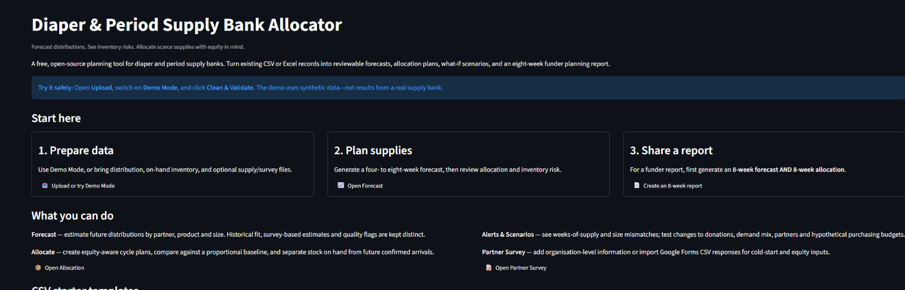
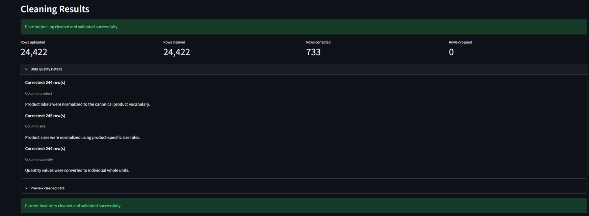
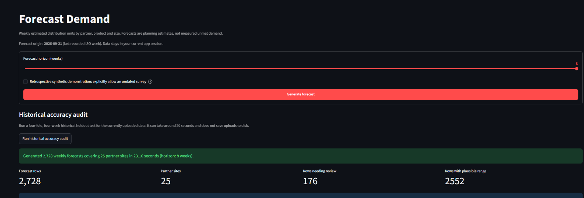
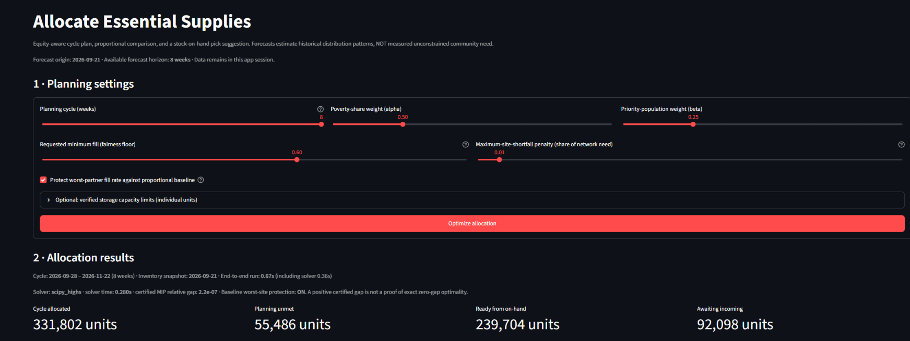
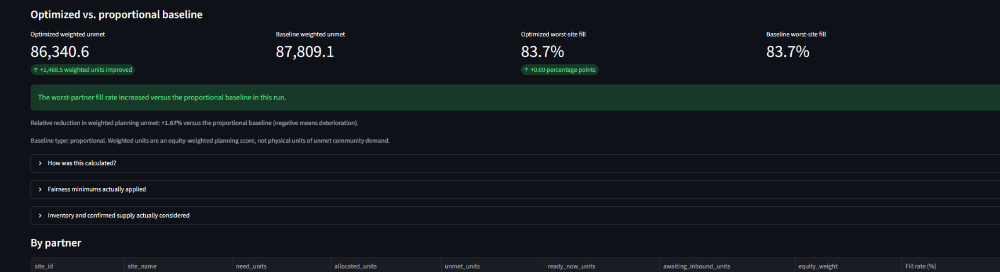
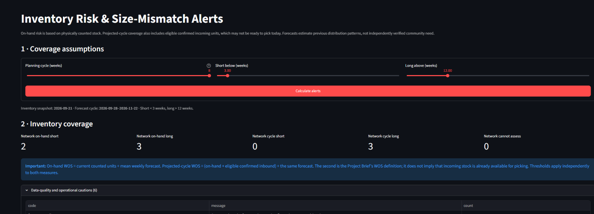
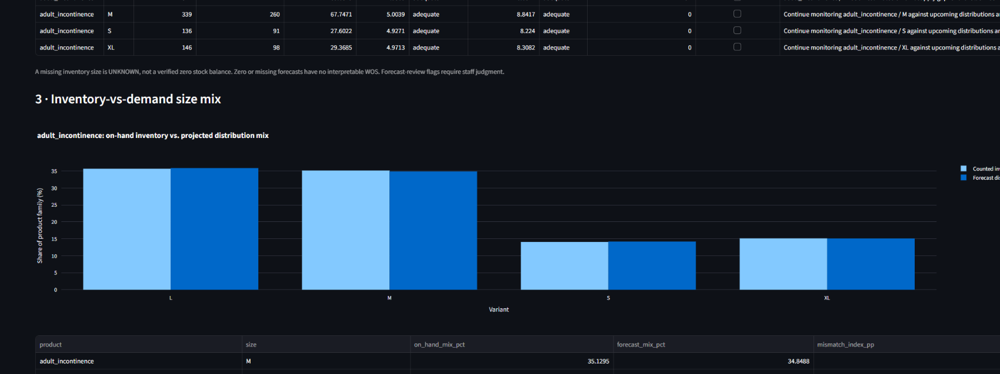
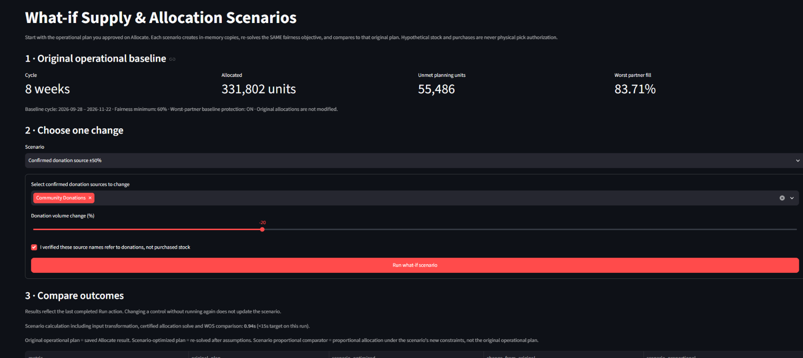
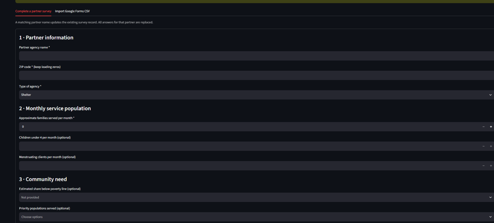
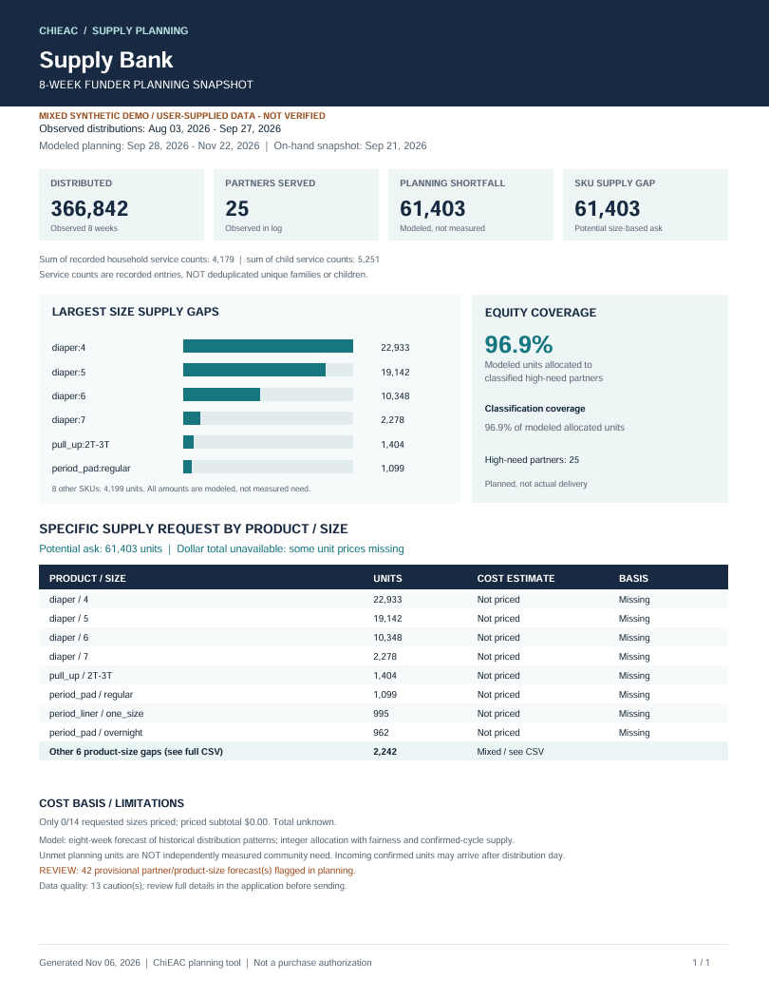

# Diaper & Period Supply Bank Allocator

**Practical User Guide | ChiEAC | Version 1.0 draft | November 6, 2026**

**Free, open-source nonprofit decision-support application**  
**Live app:** https://chieac-supply-bank-allocator.streamlit.app/  
**Project repository:** https://github.com/trnhokhai/supply-bank-allocator

> **Please read before using results.** This tool forecasts *recorded distribution patterns*, not independently measured total community need. Allocation plans, shortage estimates and hypothetical purchase lists require human review. Never use a suggested pick list or purchase estimate as authorization to ship or order supplies.

## 1. A quick start for first-time users

You can explore the app **without an account or real partner data**. Start with Demo Mode, which uses synthetic records and is intended for learning, not for grant claims.

1. Open the live link and select **Upload** from the left sidebar.
2. Turn **Demo Mode** on. Select **Clean & Validate** and review the cleaning results.
3. Open **Forecast**, choose **8 weeks**, and click **Generate forecast**. Review the quality flags before proceeding.
4. Open **Allocate**, select an **8-week planning cycle**, keep **Protect worst-partner fill rate against proportional baseline** enabled for your first run, and click **Optimize allocation**.
5. Use **Alerts** to explore inventory coverage, then **Scenarios** to investigate hypothetical changes.
6. Open **Report**, click **Generate one-page PDF**, and download the PDF and full SKU CSV. A Funder Report requires a **saved 8-week forecast and 8-week allocation**, not a 4-week result stretched to 8 weeks.

**What to expect:** the demo includes 25 synthetic partners. Your totals and timings may differ from the screenshots because choices and environments can differ. Use the instructions, not the example numbers, to decide what to do.

## 2. Prepare your organization's data

Use the four blank CSV templates on the **Home** page. Each row should describe an organization-level distribution, inventory position or inbound shipment. Do not upload individual-client records.

| Input | Required? | What staff should prepare |
|---|---|---|
| Distribution Log | **Yes** | Distribution date; partner site; canonical product and size; quantity in **individual units**. Stable site IDs and recorded household/child service counts are optional. |
| Current Inventory | **For Allocate, Alerts and Report** | A dated on-hand snapshot by product and size, with physical quantities checked by staff. |
| Incoming Supply | Optional, recommended | Expected incoming units, source, status and arrival date. Only qualifying confirmed supply arriving within the planning cycle is counted. |
| Partner Survey | Optional | Partner agency, ZIP code, type, monthly families served, and optional need indicators; helps cold-start forecasting and equity weighting. |

**Data-reading precautions:** keep ZIP codes as text so leading zeros survive; use the supplied vocabulary; distinguish units from packs or cases; do not invent missing supply records. The app supports CSV/XLSX mapping and validation, but corrections still need an operational owner's review. See [`data_dictionary.md`](data_dictionary.md) and [`partner_survey_spec.md`](partner_survey_spec.md) for exact field contracts.

**Privacy:** uploaded files are transmitted to the hosting service and processed in the active server session. The application does not intentionally persist partner uploads to a database, but the public hosted service should **not** be presumed suitable for confidential or sensitive records. Do not upload client names, personal addresses, medical details, immigration information or individual service records. Export what you need before closing the session.

## 3. Upload and review data quality

**What to do:** choose CSV/XLSX files (or Demo Mode), review the suggested header mapping, then click **Clean & Validate**. Do not proceed to planning merely because the green success banner appears; inspect the data-quality details and representative cleaned rows.

In the displayed synthetic example, the Distribution Log has **24,422 cleaned rows**, **733 corrected rows**, and **0 dropped rows**. A corrected row is one the tool standardized, such as a product label, size or unit representation. It does **not** prove the underlying historical record is accurate. The page also shows current inventory, incoming supply, survey records and derived planning tables.

**Before clicking Forecast:** check the number of sites, date range, missing weeks, normalized product sizes and whether zero-filled weeks are reasonable. If an input has validation errors, correct the source or mapping and clean again; do not force uncertain values through the model.

## 4. Forecast recorded distributions

Choose **4–8 weeks**, then click **Generate forecast**. Read the summary and **rows needing review** before relying on the numbers. Use the network chart for the overall mix and **Individual series** for the selected partner, product and size. Download CSV/XLSX outputs if staff need a review copy.

The screenshot's demo shows **2,728 weekly forecast rows across 25 partners**, including **176 rows needing review**. These are *model outputs*, not 2,728 observed deliveries or verified requests.

**How to interpret accuracy:**

- **WAPE** is weighted absolute percentage error on recorded historical distribution observations; lower is generally better. It does not measure unrecorded unmet demand.
- **Site-total backtest WAPE** describes the historical test of the site-total forecasting step; it is not interchangeable with an individual product-size pipeline WAPE.
- **N/A** can mean an eligible product-size historical audit was not run or enough comparable observations were unavailable. It is **not** proof of perfect accuracy or zero error.
- The displayed nominal **80% plausible range** is provisional. Do not describe it as a statistically calibrated or guaranteed 80% prediction interval.
- **Survey-based** forecasts for new/low-history partners are provisional and do not have invented historical WAPE.

**Decision rule:** when important sizes have review flags, confirm recent distributions, interruptions, stockouts and incoming supply with an operator before acting on the forecast.

## 5. Allocate scarce supplies carefully

After saving a Forecast, go to **Allocate**, choose the planning-cycle length (for a later Funder Report, select **8 weeks**), review the equity weights and fairness controls, and click **Optimize allocation**. For a first run, use the default values and keep worst-partner baseline protection enabled.

The screen separates two concepts: **on-hand-backed planning units** from the inventory snapshot and **future-inbound-backed planning units** that are not yet physically ready to pick. In the synthetic example the 8-week plan allocates **331,802 units**, with **55,486 modeled planning unmet**; the split shown is **239,704 on-hand-backed** and **92,098 future-confirmed-inbound-backed** units. These do not mean those units have been shipped or reserved.

**Read the comparison correctly:** the optimized plan minimizes an *equity-weighted* planning-shortfall score subject to constraints; it does not necessarily decrease total physical missing units. The comparison screenshot reports a **1.67% improvement in weighted planning unmet for that run**, while both worst-site fill percentages display **83.7%** after rounding. Do not claim a clearly measurable fill-rate increase from identical rounded values. Comparisons and figures can vary between runs and datasets.

**Before using any pick draft:** reconcile physical counts and outstanding commitments, verify receipt dates, validate partner capacity in **individual units** (case counts alone are not enforced), and obtain staff authorization. Downloaded picks are drafts, not shipping instructions.

## 6. Find inventory risks and size mismatches

Open **Alerts**, choose a planning cycle and the short/long thresholds, and click **Calculate alerts**. The default thresholds shown in the app are **short below 3 weeks** and **long above 12 weeks**.

**Two measures appear side by side:**

- **On-hand weeks of supply (WOS)** = counted on-hand units / mean weekly forecast. This helps staff see what is available now.
- **Projected-cycle WOS** = (on-hand + eligible confirmed inbound) / mean weekly forecast. It includes qualifying future deliveries, which cannot be picked until received.

A product can have WOS above the short threshold yet still show a **positive eight-week SKU supply gap**. Threshold alerts and full-cycle planning gaps answer different questions. Missing inventory, missing/zero forecasts and flagged series can be **unassessable**, not automatically healthy or out of stock.

Use the size-mix chart to compare the percentage of counted stock in each size with the percentage of forecast distributions for the same **product family**. Positive mismatch in percentage points means relatively more counted stock than projected mix; negative means relatively less. Verify the source and delivery timetable before changing allocation priorities.

## 7. Run a what-if scenario without changing the original plan

The **Scenarios** page starts from the saved original operational plan. For a simple exercise, select the confirmed donation-source change, choose **Community Donations only**, set **-20%**, verify that the chosen names genuinely refer to donations (not purchased stock), and click **Run what-if scenario**.

The example screenshot shows allocated planning units changing from **331,802 to 328,066** and modeled planning unmet from **55,486 to 59,222** after the assumed 20% donation reduction. These results are illustrative and specific to the synthetic input and settings; they do not forecast actual donations or prove an intervention's real-world effect.

**Interpretation guardrails:** the `scenario_proportional` column uses the changed scenario's constraints, not the original operational plan. Adding a hypothetical partner changes the total need denominator. Hypothetical donations or purchases never become physically ready-to-pick stock by changing a slider.

Other available what-ifs include incoming-status assumptions, demand size-mix transfers, survey/hypothetical partner addition and a **hypothetical purchase budget**. A budget scenario is not a purchase order; supplier quotes, packs/minimums, freight, lead times and approval are separate.

## 8. Maintain partner survey information

Open **Survey** to enter or update a partner record. The form requires **partner agency name, ZIP code, agency type and approximately families served per month**. Additional organizational information, such as poverty-share band and populations served, supports equity weights. The **Import Google Forms CSV** tab is another way to bring in organization-level responses; always review column mappings.

Survey edits are **session-only** and can replace a matching partner's prior record. Download the updated survey CSV if you need it later. **After saving/importing a survey, regenerate Forecast and Allocate**; the app invalidates previous downstream results to avoid stale planning outputs.

Adding a user-entered survey to synthetic Demo Mode can make the resulting report's data-source label **mixed synthetic demo and user-supplied, not verified**. That label is a warning, not evidence the added values represent actual operations.

## 9. Produce and interpret the eight-week funder snapshot

**Required sequence:** first generate an **8-week Forecast**, then an **8-week Allocate** plan. Open **Report**, verify the planning and historical periods, optionally supply a bank name/logo, and click **Generate one-page PDF**. Download both the one-page PDF and the **full SKU funding-ask CSV**.

- The PDF's source label is **automatic**: synthetic demonstration, user-uploaded unverified, mixed, or origin unverified. You cannot safely relabel a demo as real operational evidence.
- **Observed units distributed** come from logged historical distribution records. **Planning unmet** is an allocation-model shortfall. **SKU supply gap** compares modeled need with qualifying supply. These are not the same metric.
- **High-need allocation share** is about *modeled allocations* to classified partners, not observed delivered impact. If all partners are high need, a 100% share is **not an improvement claim**.
- **Unknown unit prices remain unpriced**, so the complete dollar ask is **unavailable**, not $0. Scenario cost assumptions are not supplier quotes.
- Before sending a report to a funder, a responsible staff member must verify the underlying data, dates, prices, supply timing, warning flags and interpretation. If anything is unknown, describe the estimate and its limitations accurately.

## 10. Troubleshooting without technical support

| What you see | What it usually means | Safe next step |
|---|---|---|
| "Generate forecast first" | No current forecast is saved | Return to Forecast, choose horizon, click Generate forecast. |
| Report requires eight weeks | Forecast or allocation is shorter than 8 weeks | Rebuild an **8-week** forecast and **8-week** allocation; do not extrapolate a 4-week run. |
| "Current inventory required" | No valid inventory snapshot in the current session | Upload/validate inventory and recompute downstream outputs. |
| "Needs review" or missing WAPE | Model-history quality or backtest coverage is limited | Check the specific site/SKU, distribution history, gaps and assumptions. |
| Incoming units are not ready to pick | Qualifying future arrivals are included in the cycle, not physically received | Verify receiving records and actual on-hand stock before pick decisions. |
| The full funding total is N/A | One or more positive-gap SKUs lack a trusted unit cost | Leave unknowns blank; obtain quotes instead of using $0. |
| Old report disappears after new upload/survey | Dependent planning states were invalidated for integrity | Regenerate Forecast, Allocate and Report. |
| Hosted app appears inactive | Public hosting can hibernate or restart | Reopen the app, rerun the current session if needed, and preserve exported CSV/PDF files. |

## 11. Plain-language glossary and final decision checklist

| Term | Meaning for staff |
|---|---|
| Forecast units | Estimated future **distributions**, not verified requests or unconstrained need. |
| WAPE | Historical forecast error against *recorded* observations; not a service-impact score. |
| Fill rate | Share of modeled need receiving planned units for a partner. |
| Equity-weighted unmet | Modeled shortfall score weighted by survey-based priority factors; **not** physical missing-unit count. |
| Worst-site fill | Lowest partner-level modeled fill rate under the selected plan. |
| On-hand-backed | Units supported by an inventory snapshot; still require physical verification. |
| Future-inbound-backed | Planned availability through confirmed incoming supply; not ready now. |
| WOS | Weeks of supply under the selected forecast and inventory assumptions. |
| Supply gap | Positive modeled size-level planning difference between forecast need and eligible supply. |
| Provisional / requires review | Model or data evidence is incomplete and staff must investigate. |

**Before an operational action, confirm:** (1) the source is appropriate and non-sensitive; (2) inventory is current and counted; (3) shortages and flags were reviewed; (4) the receipt timeline and capacity are feasible; (5) any purchase price has a traceable quote; (6) an authorized human approved the action. Treat the app as **decision support**, not an automatic purchasing or shipping system.

**Support and stewardship:** this free tool was built as a ChiEAC Fellowship contribution. See the repository README and [onboarding checklist](onboarding_checklist.md). Organizational hosting and maintenance ownership should be confirmed with ChiEAC; this document does not promise a commercial support service or paid onboarding.
